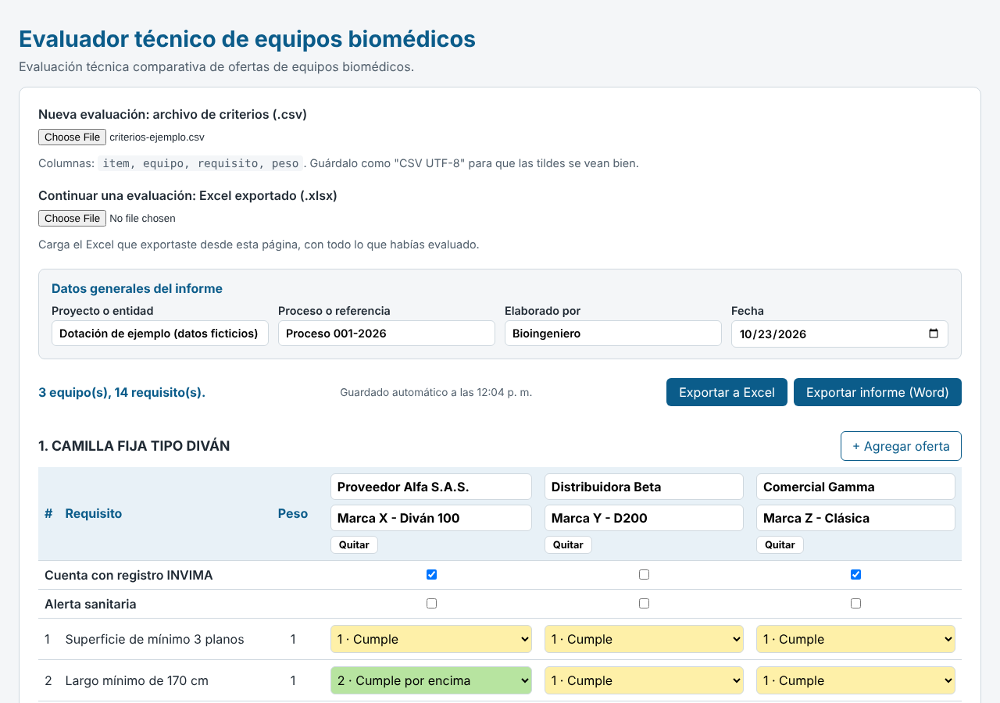
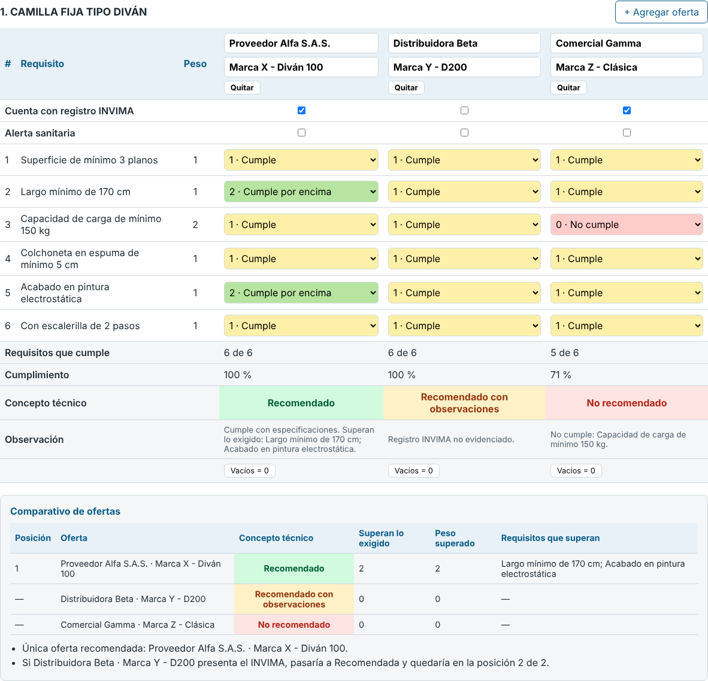
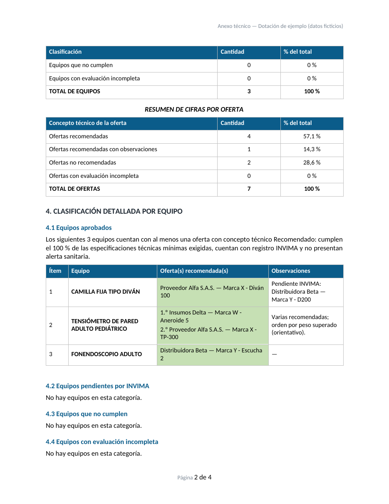

# Evaluador técnico de equipos biomédicos

Herramienta web para **evaluar y comparar ofertas de equipos biomédicos** frente a una matriz de requerimientos técnicos, y generar el **informe técnico** del proceso. Funciona completamente en el navegador: no necesita servidor, instalación ni base de datos.

**Demo en línea:** https://JuanSarmientoCanchila.github.io/Evaluador_Tecnico_Biomedico/

> Los datos de ejemplo (equipos, proveedores y marcas) son ficticios.



## ¿Qué problema resuelve?

En los procesos de adquisición de tecnología biomédica, cada oferta se revisa requisito por requisito contra una matriz que puede tener cientos de filas y decenas de equipos. Hacerlo a mano en hojas de cálculo es lento y propenso a errores, y armar después el informe técnico repite el trabajo.

Esta herramienta:

- Carga la matriz de requerimientos (ítem, equipo, requisito y peso) desde un archivo CSV.
- Permite calificar cada oferta requisito por requisito y calcula el cumplimiento y el concepto técnico.
- Compara las ofertas recomendadas de cada equipo.
- Exporta la evaluación a Excel, permite retomarla después y agregar cotizaciones nuevas.
- Exporta el informe técnico en Word.

## Cómo se usa

1. **Cargar los criterios.** En "Nueva evaluación" selecciona el CSV con la matriz. Cada equipo aparece con sus requisitos y dos ofertas para empezar; se pueden agregar o quitar ofertas.
2. **Completar datos generales.** Proyecto o entidad, proceso o referencia, quién elabora y fecha.
3. **Evaluar cada oferta.** Se escribe el proveedor y la marca - modelo, se marcan las casillas de registro INVIMA y alerta sanitaria, y cada requisito se califica como:
   - **0 · No cumple**
   - **1 · Cumple**
   - **2 · Cumple por encima** (solo se anota, no suma al porcentaje)
4. **Revisar el comparativo** que se muestra debajo de cada equipo.
5. **Exportar.** A Excel para conservar el trabajo y retomarlo, y a Word para el informe técnico.



## Reglas del concepto técnico

| Situación de la oferta | Concepto |
|---|---|
| Tiene alerta sanitaria | No recomendado |
| Quedan requisitos sin evaluar | Evaluación incompleta |
| Algún requisito en 0 | No recomendado |
| Cumple el 100 % de lo técnico y tiene registro INVIMA | Recomendado |
| Cumple el 100 % de lo técnico, pero no evidencia registro INVIMA | Recomendado con observaciones |

- El porcentaje de cumplimiento es ponderado: suma de pesos cumplidos sobre suma de pesos totales.
- Calificar un requisito con 2 no compensa otro en 0 ni aumenta el porcentaje: superar lo exigido no reemplaza cumplir lo mínimo.

## Comparativo entre ofertas

El comparativo evalúa cada oferta contra el requerimiento, no contra las demás. Entre las ofertas **recomendadas** de un mismo equipo, ordena por el peso de los requisitos que superan lo exigido; si hay igualdad, indica empate técnico. Es un criterio de desempate **orientativo**: superar lo pedido no implica mayor calidad.

Si una oferta quedó como "Recomendado con observaciones", la página indica en qué posición quedaría si presentara el registro INVIMA.

## Excel: guardar y retomar

La exportación genera un libro con tres hojas:

- **Evaluación:** vista legible, con colores y resultados.
- **Datos:** tabla plana (ítem, equipo, requisito, peso, oferta, proveedor, modelo, INVIMA, alerta, valor).
- **General:** datos generales del informe.

Para continuar una evaluación se carga ese mismo Excel: la página lo valida por completo antes de aceptarlo (si algo está mal, no carga nada y lo explica) y reconstruye la evaluación, de modo que se pueden sumar cotizaciones nuevas sin volver a empezar.

## Informe técnico en Word

Genera un documento con la estructura de un anexo técnico:

- Datos generales del proceso.
- Objetivo y metodología.
- Resultados en cifras: por equipo y por oferta.
- Clasificación por equipo: aprobados, pendientes por INVIMA, no cumplen y con evaluación incompleta.
- Conclusiones, con espacio para que el evaluador redacte.
- Anexo con el detalle de cada oferta.



## Formato del CSV de criterios

```csv
item,equipo,requisito,peso
1,CAMILLA FIJA TIPO DIVÁN,Superficie de mínimo 3 planos,1
1,CAMILLA FIJA TIPO DIVÁN,Capacidad de carga de mínimo 150 kg,2
2,FONENDOSCOPIO ADULTO,Libre de látex,2
```

- Guardar como **CSV UTF-8** para que las tildes se lean bien.
- Si el peso está vacío, vale 1.
- Un mismo ítem puede agrupar varios equipos.
- Si hay errores (equipo o requisito vacío, peso no numérico), la página los lista con el número de línea.

Para preparar la matriz a partir de un Excel con celdas combinadas se puede usar un script corto de pandas (relleno de celdas combinadas, limpieza de espacios y exportación a CSV).

## Privacidad y autoguardado

- Todo ocurre en el navegador: ningún dato se envía a un servidor.
- La página guarda una copia automática en el propio navegador (`localStorage`) y ofrece recuperarla al volver a abrirla. Esa copia solo existe en ese navegador y en esa dirección; el Excel exportado es la copia que se puede conservar y compartir.

## Tecnologías

- HTML, CSS y JavaScript sin frameworks.
- [ExcelJS](https://github.com/exceljs/exceljs) para exportar e importar Excel.
- [docx](https://github.com/dolanmiu/docx) para generar el informe en Word.

## Estructura del proyecto

| Archivo | Función |
|---|---|
| `index.html`, `style.css` | Interfaz |
| `app.js` | Lógica de la interfaz y eventos |
| `csv.js` | Lectura y validación del CSV de criterios |
| `calculo.js` | Cumplimiento y concepto técnico |
| `comparativo.js` | Comparación entre ofertas recomendadas |
| `resumen.js` | Clasificación de equipos para el informe |
| `exportar.js`, `importar.js` | Excel: exportar e importar |
| `informe.js` | Informe técnico en Word |
| `autoguardado.js` | Copia automática en el navegador |
| `criterios-ejemplo.csv` | Matriz de ejemplo para probar |

## Alcance

La herramienta apoya la evaluación técnica y de cumplimiento normativo de las ofertas. No evalúa costos ni soporte posventa, y el concepto que calcula no reemplaza el criterio del evaluador, que revisa y firma el informe.

## Autor

**Juan Diego Sarmiento Canchila** · Bioingeniero, Universidad de Antioquia.
